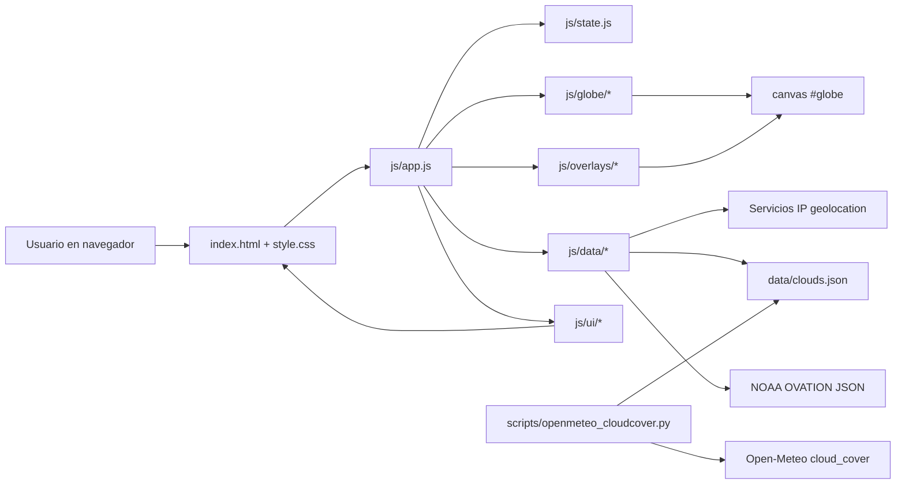
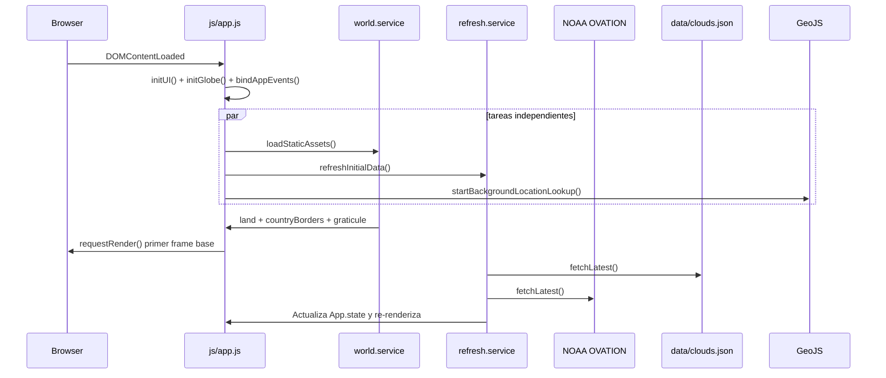
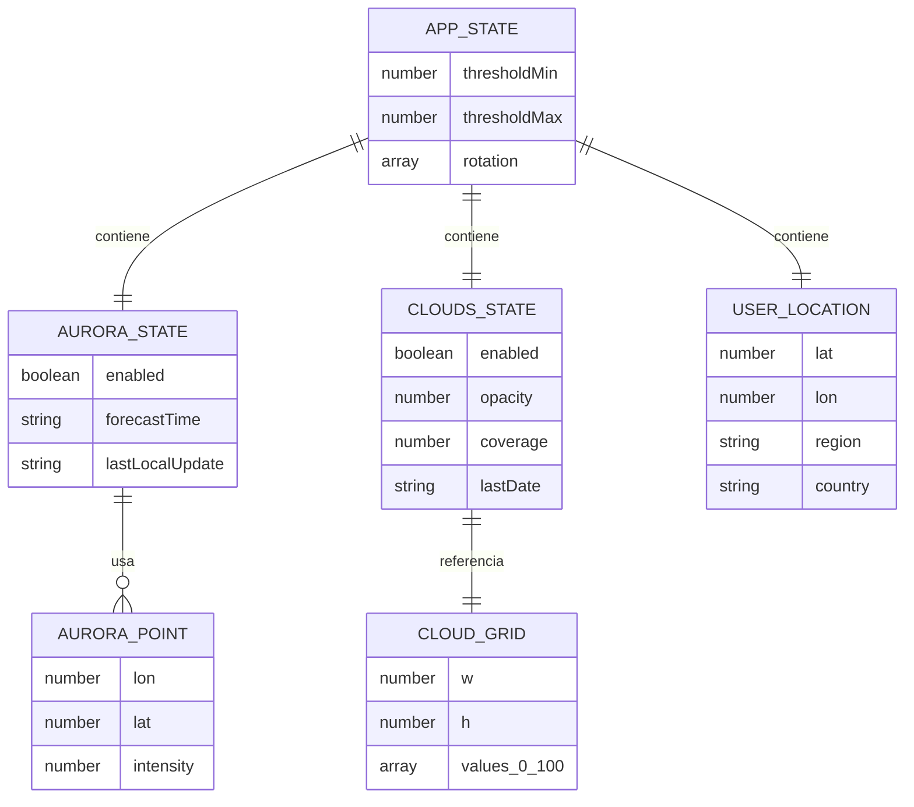
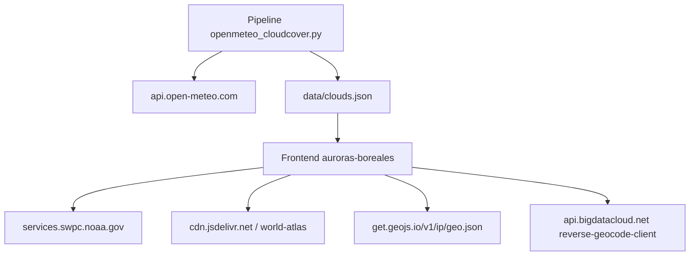

# auroras-boreales

Aplicación web estática para visualizar actividad auroral sobre un globo 3D, combinando el feed OVATION de NOAA con una capa de nubosidad generada desde Open-Meteo y una máscara dinámica de día/noche.

## Tabla de contenido
- [Arquitectura](#arquitectura)
- [Código fuente](#código-fuente)
- [Modelo de datos](#modelo-de-datos)
- [Reglas de negocio](#reglas-de-negocio)
- [Funcionalidad](#funcionalidad)
- [Integraciones](#integraciones)
- [Infraestructura](#infraestructura)
- [Seguridad](#seguridad)
- [Operación](#operación)
- [Pruebas](#pruebas)
- [Rendimiento](#rendimiento)
- [Governanza](#governanza)
- [Conocimiento](#conocimiento)
- [Evolución](#evolución)
- [Runtime](#runtime)
- [Regulatorio](#regulatorio)
- [Gestión de cambio](#gestión-de-cambio)
- [Resiliencia](#resiliencia)
- [Licenciamiento](#licenciamiento)
- [Migración](#migración)

## Arquitectura

La solución sigue una arquitectura **frontend estática modular**. No hay backend de aplicación en tiempo de ejecución: el navegador consume fuentes remotas y un artefacto local (`data/clouds.json`) previamente generado.

### Capas principales
- **Presentación:** `index.html` y `style.css` definen la shell visual, paneles laterales y canvas principal.
- **Estado compartido:** `js/state.js` centraliza umbrales, rotación del globo, selección, datos de aurora, nubosidad, cachés derivados de probabilidad y geolocalización.
- **Servicios de datos:** `js/data/*.js` encapsula consumo de NOAA, archivos locales, geolocalización por IP, refresco coordinado y derivaciones reutilizables de probabilidad geoespacial.
- **Renderizado geoespacial:** `js/globe/*.js` y `js/overlays/*.js` pintan continentes, auroras, nubes, probabilidad derivada y día/noche sobre un canvas 2D con D3.
- **Interacción/UI:** `js/ui/*.js` sincroniza sliders, toggles, paneles de inspección, el control de categorías de probabilidad y metadatos de versión.
- **Preproceso offline:** `scripts/openmeteo_cloudcover.py` consulta la nubosidad actual de Open-Meteo en una rejilla de 5° y la interpola a 360x180 para producir `data/clouds.json`.

### Diagrama de arquitectura



### Flujo principal de arranque



## Código fuente

### Estructura relevante

```text
.
├── index.html
├── style.css
├── tratamiento-datos.html
├── explicacion-sitio.html
├── data/
│   ├── clouds.json
│   └── history/
├── js/
│   ├── app.js
│   ├── config.js
│   ├── events.js
│   ├── state.js
│   ├── utils.js
│   ├── data/
│   ├── globe/
│   ├── overlays/
│   └── ui/
├── scripts/
│   └── openmeteo_cloudcover.py
└── versor.js
```

### Responsabilidades por módulo
- `js/config.js`: parámetros globales, endpoints, límites, opacidad, sampling y metadatos de versión embebidos para el despliegue.
- `js/app.js`: orquesta el bootstrap en fases pequeñas (`initUI`, `initGlobe`, `bindAppEvents`, `loadStaticAssets`, `startBackgroundLocationLookup`, `refreshInitialData`) y separa el primer frame base de las tareas en background.
- `js/data/ovation.service.js`: normaliza coordenadas NOAA y extrae `Forecast Time`.
- `js/data/clouds.service.js`: carga el artefacto local de nubosidad con `cache: no-store`.
- `js/data/refresh.service.js`: ejecuta refresco concurrente y tolera fallos parciales en nubes.
- `js/data/probability.service.js`: centraliza la clasificación de visibilidad, la lectura puntual de aurora/nubes, el índice auroral y la generación diferida/cacheada de una grilla global de 1°.
- `js/data/location.service.js`: consulta la ubicación del dispositivo (`navigator.geolocation` + BigDataCloud para nombres) o, como respaldo, la geolocalización por IP mediante JSON con CORS (GeoJS), y normaliza la respuesta al estado de la app.
- `js/overlays/*.js`: renderizado de auroras, nubes, probabilidad derivada y sombra nocturna.
- `js/ui/*.js`: manipulación de DOM y sincronización con estado/eventos, incluyendo toggles de capas, sliders y filtros de probabilidad.
- `scripts/openmeteo_cloudcover.py`: pipeline offline para generar la malla global de nubosidad.

## Modelo de datos

### Estado en memoria (`App.state`)
- `thresholdMin` / `thresholdMax`: rango de intensidad auroral visible.
- `rotation`: orientación del globo.
- `aurora.points`: arreglo de puntos `[lon, lat, intensidad, cartesian]`.
- `aurora.forecastTime`: fecha/hora publicada por NOAA.
- `clouds.gridNormalized`: grid normalizado a valores `[0..1]` listo para render.
- `clouds.coverage`: porcentaje global de nubosidad.
- `selection`: punto actualmente inspeccionado, incluida su clasificación canónica de visibilidad `{ key, label, range, color }`.
- `probability.enabled` y `probability.filters`: controlan la capa visual de probabilidad y las categorías canónicas `high`/`medium`/`low` habilitadas.
- `probability.gridCache`: caché derivada desde aurora + nubosidad para pintar categorías sin depender de etiquetas visibles ni acentos.
- `probability.auroraIndex`: índice espacial por celdas enteras para resolver la intensidad más cercana sin recorrer toda la malla derivada.
- `userLocation`: localización inferida por IP.

### Feed de auroras esperado

```json
{
  "Forecast Time": "2026-03-23T00:00:00Z",
  "coordinates": [[-100.0, 65.0, 35], [-95.0, 64.5, 42]]
}
```

### Artefacto local de nubes

```json
{
  "source": "Open-Meteo",
  "product": "cloud_cover (current)",
  "date": "YYYY-MM-DD",
  "observed_at": "YYYY-MM-DDTHH:MMZ",
  "retrieved_at": "YYYY-MM-DDTHH:MM:SSZ",
  "sds": "cloud_cover",
  "source_grid_step_deg": 5,
  "coverage_percent_global": 12.34,
  "grid": {
    "w": 360,
    "h": 180,
    "values_0_100": [0, 0, 5, 12]
  }
}
```

### Diagrama del modelo



## Reglas de negocio
- Solo se dibujan auroras si la capa está habilitada y el punto cae dentro del umbral configurado por el usuario.
- Se filtran puntos aurorales por latitud absoluta mínima para evitar ruido lejos de zonas polares.
- El render de auroras y nubes omite puntos que quedan “detrás” del hemisferio visible mediante producto punto cartesiano.
- La nube visible se restringe al rango seleccionado por el usuario en porcentaje normalizado.
- La geolocalización por IP es oportunista: si falla, la aplicación sigue operando.
- El bootstrap inicial ejecuta en paralelo la carga del atlas base, el primer `refreshAll()` y la localización por IP; solo la disponibilidad de assets base bloquea el primer `requestRender()`.
- La probabilidad de visibilidad del punto inspeccionado y del overlay derivado se clasifica por intersección de datos: toma la intensidad OVATION más cercana, la nubosidad de la celda correspondiente y aplica una matriz discreta canónica `high`/`medium`/`low` (`Alta`/`Media`/`Baja`).
- La matriz de negocio actual clasifica `Alta` cuando la intensidad es `>= 70` y la nubosidad `<= 30%`; `Media` cuando la intensidad es `>= 30` y `< 70` con nubosidad `<= 30%`; y `Baja` en cualquier otro caso.
- Cada categoría de probabilidad comparte la misma estructura `{ key, label, range, color }` para picking, inspector, overlay, filtros y cachés de puntos.
- Antes de clasificar `Alta`/`Media`/`Baja`, la grilla derivada descarta cualquier coordenada cuya intensidad no alcance el umbral de relevancia auroral (`App.config.probability.minRelevantIntensity`, con fallback a `App.state.thresholdMin`).
- La capa `Probabilidad` inicia apagada; al activarse reutiliza simultáneamente los filtros de intensidad y nubosidad ya presentes para pintar solo las categorías habilitadas, dejando las tres categorías activadas por defecto desde el estado inicial.
- El filtro por categorías permite mostrar u ocultar `Alta`, `Media` y `Baja` sin alterar los datos base de aurora o nubosidad; la única fuente de verdad operativa es `App.state.probability.filters`.
- La capa de probabilidad solo dibuja la cara visible del globo, oculta cualquier punto donde sea de día en la fecha/hora actual, se regenera cuando cambia cualquiera de las dos fuentes cruzadas (aurora o nubosidad) y difiere la reconstrucción pesada de la grilla hasta `getOverlayCache(step)`.
- La lectura auroral reutilizable usa un índice espacial por celdas enteras y compara primero vecinos locales antes de recurrir a un fallback más amplio, para que la grilla global derivada de 1° sea viable en el navegador.
- El resumen cromático de la capa usa la paleta Okabe-Ito, distinguible con daltonismo rojo-verde: `Alta` en verde azulado, `Media` en amarillo y `Baja` en bermellón.
- El refresco de datos acepta degradación parcial: si falla nubosidad, la app puede seguir mostrando auroras.
- `clouds.json` se considera una instantánea diaria/preprocesada, no una fuente en vivo de alta frecuencia.
- La versión visual expuesta al usuario se toma primero desde `App.config.version` (metadata embebida/inyectable en build o despliegue) y solo consulta remoto si se habilita explícitamente un refresco opcional con caché TTL en `localStorage`.

## Funcionalidad
- Visualización del globo interactivo con arrastre y selección de puntos, ajustada al alto útil del panel principal.
- Activación/desactivación de capas de aurora, nubosidad, probabilidad derivada y máscara día/noche.
- Ajuste de umbrales de intensidad auroral y nubosidad mediante sliders dobles.
- Servicio reutilizable para muestrear cualquier coordenada `(lon, lat)`, construir el payload del punto seleccionado y producir una grilla global cacheada de probabilidad a resolución explícita de 1°, filtrada por relevancia auroral antes de clasificar categorías.
- Nueva capa `Probabilidad` derivada del cruce entre intensidad auroral y nubosidad, con estado inicial apagado para no sobrecargar la vista base y con exclusión dinámica de puntos en zonas actualmente diurnas.
- Ajuste de umbrales de intensidad auroral y nubosidad mediante sliders dobles; la capa de probabilidad reutiliza ambos rangos para definir qué celdas son candidatas a mostrarse.
- Panel de detalle del punto seleccionado con latitud, longitud, intensidad, nubosidad, condición día/noche y probabilidad de visibilidad estimada.
- Tarjeta `Capas visibles` con un toggle adicional para la capa `Probabilidad` y una tarjeta específica de categorías para filtrar `Alta`, `Media` y `Baja`, con las tres categorías activadas por defecto.
- Resumen visual de colores para la capa derivada (Okabe-Ito): alta en verde azulado, media en amarillo y baja en bermellón; los filtros muestran una muestra de color como leyenda.
- El pronóstico de auroras se recarga solo cada 5 minutos mientras la pestaña está visible (y al volver a ella si los datos son viejos); `App.config.aurora.autoRefreshMs` controla el intervalo.
- Aviso visible sobre el globo cuando falla NOAA (con reintentos a los 30 s, 1, 2 y 5 min, conservando los últimos datos), cuando falla el mapa base (reintento cada 30 s) o cuando no hay nubosidad.
- Accesibilidad: el globo se maneja con teclado (flechas giran, `+`/`-` acercan, Enter consulta el centro, Inicio resetea), tiene una descripción textual que cambia con la vista y el detalle del punto se anuncia con `aria-live`.
- Panel de localización inferida por IP.
- Panel de estado con versión y última actualización de datos.
- Tarjeta `Pronóstico Kp (3 días)` con el índice Kp de NOAA SWPC en bloques de 3 h (hora local), máximo por día con escala de tormenta G1–G5 y el Kp aproximado que hace falta en la ubicación de la persona (latitud geomagnética por dipolo centrado). Se recarga cada 30 min y con "Refrescar datos" (`js/data/kp.service.js`, `js/ui/kp-forecast.ui.js`).
- Tarjeta `Alertas de aurora`: con la página abierta, revisa la probabilidad en la ubicación de la persona (OVATION + nubosidad + noche) en cada actualización de datos y cada 10 min. Si llega al nivel elegido (`Alta` o `Media o alta`) muestra un aviso en la página y, con permiso, una notificación del navegador (como máximo una cada 3 h salvo que suba de nivel). Preferencias en `localStorage` (`auroras-boreales:alerts`). No hay servidor push; las notificaciones con el sitio cerrado quedan para la PWA del backlog (`js/ui/alerts.ui.js`).
- Modo oscuro: sigue `prefers-color-scheme` y tiene un interruptor en el encabezado de las tres páginas; la elección se guarda en `localStorage` (`auroras-boreales:theme`). `js/theme.boot.js` se carga sin `defer` en el `<head>` para fijar `data-theme` antes del primer pintado; el globo cambia sus colores base según el tema.
- Página secundaria `tratamiento-datos.html` con documentación de fuentes y tratamiento.
- Página secundaria `explicacion-sitio.html` que consolida la explicación ejecutiva y académica del proyecto a partir del README y los materiales de la carpeta `presentaciones/`, con diagramas Mermaid y láminas SVG presentados con criterios homogéneos de contraste, escala y narrativa explicativa para facilitar su lectura en web; además, fuerza color de tipografía claro en nodos/etiquetas para evitar pérdidas de legibilidad en Safari/iPad.

## Integraciones

### Externas
- **NOAA SWPC:** feed JSON `ovation_aurora_latest.json` y pronóstico Kp `products/noaa-planetary-k-index-forecast.json` (acepta el formato de tabla con encabezados y el de objetos).
- **world-atlas / jsDelivr:** topología mundial para masa continental y fronteras.
- **Metadata de versión embebida:** `js/config.js` publica la etiqueta/fecha visible y puede inyectarse durante build o despliegue; el refresco remoto hacia GitHub queda deshabilitado por defecto y es opcional.
- **BigDataCloud (`reverse-geocode-client`):** traduce las coordenadas del dispositivo a estado y país. Gratuito, sin clave, pensado para uso desde el navegador. Solo se llama tras "Usar mi ubicación" y recibe coordenadas redondeadas a 2 decimales (~1 km).
- **GeoJS (`/v1/ip/geo.json`):** respaldo por IP y único proveedor de estimación geográfica por IP, consumido desde el navegador como JSON con CORS. JSONP (ipapi.co) se retiró en 2026-11-16 porque inserta un `<script>` de terceros con acceso completo a la página.
- **Open-Meteo (`api.open-meteo.com/v1/forecast`):** nubosidad actual (`cloud_cover`) consultada offline cada 8 horas; gratuita para uso no comercial y sin clave. Atribución requerida: "Weather data by Open-Meteo.com" (CC BY 4.0).

### Diagrama de integraciones



## Infraestructura
- **Hosting objetivo:** sitio estático, compatible con GitHub Pages o cualquier servidor HTTP simple.
- **Dependencias runtime del navegador:** D3 v7, TopoJSON Client y `versor.js` cargados por script tag.
- **Dependencias del pipeline offline:** Python, `requests` y `numpy`. No requiere tokens ni secretos.
- **Persistencia:** archivos versionados en Git (`data/clouds.json`). Los históricos de `data/history/` se sacaron del repositorio en noviembre de 2026 y están en `.gitignore`.
- **Red de entrega:** endpoints públicos HTTPS y contenido estático servido por CDN o repositorio.
- **Empaquetado de Pages:** el workflow de despliegue publica un bundle curado que excluye `scripts/`, `tests/`, `AGENTS.md` y `data/history/`, e inyecta en `js/config.js` la fecha y el commit desplegados como versión visible.

## Seguridad
- No existe autenticación ni manejo de cuentas de usuario en la aplicación web actual.
- La localización es aproximada y basada en IP; la geolocalización precisa del navegador solo se pide si la persona pulsa "Usar mi ubicación".
- No se carga código de proveedores de ubicación (sin JSONP) y la versión se pinta sin `innerHTML`.
- Los diagramas Mermaid de `explicacion-sitio.html` usan `securityLevel: 'strict'`.
- La app depende de orígenes externos; conviene endurecer la política de contenido (`CSP`) si se despliega en producción propia.
- El proyecto debe revisar periódicamente que URLs externas, esquemas JSON y dependencias CDN no cambien de forma incompatible.

## Operación

### Ejecución local
```bash
python -m http.server 8000
```
Luego abrir `http://localhost:8000`.

### Actualización de nubosidad
```bash
python scripts/openmeteo_cloudcover.py
```

### Operación diaria recomendada
1. Generar o actualizar `data/clouds.json` desde el pipeline de nubosidad cuando corresponda.
2. Verificar que el feed NOAA responde y que el frontend carga las capas en vivo.
3. Publicar cambios estáticos en la rama servida, sabiendo que GitHub Pages excluye `data/history/` del artefacto desplegado.
4. Revisar `tratamiento-datos.html` y `README.md` cuando cambien fuentes, reglas, pipelines o endpoints.

## Pruebas
El workflow `Tests` (`.github/workflows/tests.yml`) corre en cada push a `main`: revisa la sintaxis de todos los JS con `node --check` y ejecuta `node --test tests/*.test.js`, que carga los scripts en un contexto aislado y prueba la lógica pura (clasificación de probabilidad, longitudes, rejilla de nubes, posición del sol, colores de aurora). No necesita dependencias. Además, `AGENTS.md` establece que toda intervención del agente debe ejecutar siempre pruebas, validaciones o checks proporcionales al cambio antes de cerrarlo, y debe reportar el comando exacto usado. La validación operativa recomendada es:
- Servir el sitio localmente y revisar que el canvas renderiza sin errores en consola.
- Confirmar que el refresco actualiza auroras aunque falle la fuente de nubes.
- Probar cambios de umbrales y toggles en desktop y móvil.
- Verificar que `scripts/openmeteo_cloudcover.py` produce un `clouds.json` válido.
- Revisar manualmente que `tratamiento-datos.html`, `README.md` y `AGENTS.md` sigan alineados.

## Rendimiento
- Auroras, nubes y probabilidad se dibujan agrupadas por color: un `fill()` por color (5 de aurora, 16 niveles de nube, 3 categorías) en lugar de uno por punto.
- Las auroras no se submuestrean: el filtro por umbral y latitud descarta casi todos los puntos. Las nubes usan `sampleStep` según el viewport y la mitad de celdas mientras se arrastra el globo.
- La capa de probabilidad calcula la posición del sol una vez por frame y mover el slider de intensidad no reconstruye el índice auroral.
- Se topa el device pixel ratio (`dprMax`) para evitar sobrecoste en pantallas densas.
- Se usa caché de malla de nubes (`gridCache`) para no recalcular puntos en cada frame.
- La capa de probabilidad reutiliza una caché derivada con puntos enriquecidos por una categoría canónica `{ key, label, range, color }`, minimizando trabajo durante rotación o drag.
- El grid de nubes se transporta como arreglo plano compacto `values_0_100`.
- La geolocalización no bloquea el render principal y la versión visible se resuelve localmente antes de cualquier refresco remoto opcional.

## Governanza
- El repositorio se rige por documentación viva: `README.md` para visión integral y `AGENTS.md` para bitácora operativa.
- Toda modificación funcional debería dejar evidencia en archivos de documentación cuando afecte arquitectura, reglas, fuentes o operación.
- Si se inyecta metadata de versión en `js/config.js`, esa etiqueta/fecha debe mantenerse coherente con el despliegue real; si se habilita refresco remoto, su endpoint y TTL también deben documentarse.

## Conocimiento
- El dominio principal combina geovisualización, clima espacial y nubosidad satelital.
- La página `tratamiento-datos.html` documenta privacidad, fuentes y procesamiento orientado al usuario final.
- `AGENTS.md` conserva decisiones, aprendizajes, riesgos y próximos pasos para mantener continuidad de trabajo.
- Los datos históricos de `data/history/` (snapshots OVATION de feb–mar 2026, unos 3.1 GB) se retiraron del repositorio en noviembre de 2026; siguen disponibles en el historial de Git anterior a ese cambio.

## Evolución
Áreas naturales de evolución:
- Incorporar tests automatizados para normalización y utilidades de grid.
- Separar más claramente la capa de dominio de la de renderizado.
- Versionar explícitamente snapshots de nubes y auroras en UI.
- Añadir observabilidad básica de fallos de endpoints externos.
- Evaluar migración de módulos IIFE a ES Modules o TypeScript.

## Runtime
- **Navegador:** aplicación SPA ligera basada en scripts globales y canvas.
- **Entorno de script:** Python para generación offline de artefactos de nubosidad.
- **Frecuencia de refresco visual de día/noche:** cada 60 segundos por defecto.
- **Refresco de datos:** manual vía botón y al cargar la aplicación.

## Regulatorio
- El proyecto debe mantener transparencia sobre fuentes de datos, finalidad y tratamiento en `tratamiento-datos.html`.
- La geolocalización por IP debe comunicarse como aproximada y no determinística.
- Si el despliegue incorpora analítica, cookies u otros identificadores, la documentación regulatoria deberá ampliarse.
- Se recomienda mantener trazabilidad entre documentación pública y endpoints reales configurados.

## Operación de workflows
- Los workflows `Collect OVATION Snapshots` y `Build OVATION Global Merge` se retiraron el **23 de marzo de 2026** porque la aplicación ya consume OVATION directamente desde NOAA en tiempo real y no requiere recolectar snapshots ni consolidarlos.
- El único artefacto recolectado que permanece operativo para el frontend es `data/clouds.json`, generado por el workflow `Update cloud cover (Open-Meteo)` (cada 8 horas). Sustituyó en noviembre de 2026 al workflow de MODIS/LAADS, que dependía de un token de Earthdata con caducidad de 60 días.
- El despliegue de GitHub Pages empaqueta una carpeta `dist/` y excluye `data/history/` para evitar publicar históricos o derivados de recolección.

## Gestión de cambio

- La documentación visible del sitio debe mantenerse alineada entre `README.md`, `tratamiento-datos.html`, `explicacion-sitio.html` y los materiales base en `presentaciones/`.

- Cualquier cambio en arquitectura, fuentes, endpoints, reglas de negocio, operación o cumplimiento debe reflejarse en `README.md`.
- Cualquier cambio relevante de contexto, decisiones, pendientes o riesgos debe registrarse en `AGENTS.md`.
- Cualquier cambio debe incluir pruebas o verificaciones ejecutadas de forma proporcional al alcance; si no existe suite formal, deben documentarse checks mínimos reproducibles y su resultado.
- Cuando una actualización toque documentación de tratamiento, también debe revisarse la coherencia entre `README.md`, `AGENTS.md` y `tratamiento-datos.html`.
- Los cambios de infraestructura o integración deberían incluir un diagrama Mermaid actualizado cuando alteren el flujo actual.

## Resiliencia
- El refresco usa `Promise.allSettled`, lo que permite tolerar fallos parciales.
- La geolocalización por IP usa solo `get.geojs.io/v1/ip/geo.json` (JSON con CORS); si falla, la app sigue funcionando sin marcador de ubicación. No se usa JSONP para no ejecutar código de terceros.
- El botón **"Usar mi ubicación"** pide la posición del dispositivo con `navigator.geolocation` (solo tras un clic, con el permiso del navegador). Es más preciso que la IP, que con datos móviles suele apuntar a la ciudad del operador. La elección se recuerda en `localStorage` y, en visitas siguientes, se usa sin preguntar si el permiso sigue concedido; si no, se vuelve a la IP. Al obtenerla, el globo se centra en ese punto.
- La UI mantiene funcionalidad básica aun sin `clouds.grid`, mostrando al menos cobertura global cuando existe.
- El sombreado día/noche se recalcula localmente sin depender de APIs externas una vez cargada la app.

## Licenciamiento
Este repositorio no declara todavía una licencia explícita en un archivo dedicado. Antes de uso externo amplio o contribuciones abiertas, conviene:
- definir una licencia del código,
- revisar compatibilidad de datos y dependencias externas,
- documentar restricciones de uso de fuentes NOAA, NASA/LAADS y servicios de terceros.

## Migración
Posibles rutas de migración futura:
- **A módulos ES / bundler:** para mejorar mantenibilidad y testing.
- **A TypeScript:** para reforzar contratos de datos y estado.
- **A backend liviano opcional:** si se requiere cachear integraciones o proteger secretos.
- **A pipeline CI/CD:** para regenerar `clouds.json`, validar documentación automáticamente y empaquetar el sitio con exclusiones explícitas de artefactos recolectados.

### Consideraciones para migrar
- Conservar el contrato de `App.state` o introducir una capa adaptadora.
- Mantener compatibilidad del esquema de `data/clouds.json` hasta versionarlo.
- Asegurar que el nuevo runtime no rompa la carga por GitHub Pages si ese sigue siendo el target.
